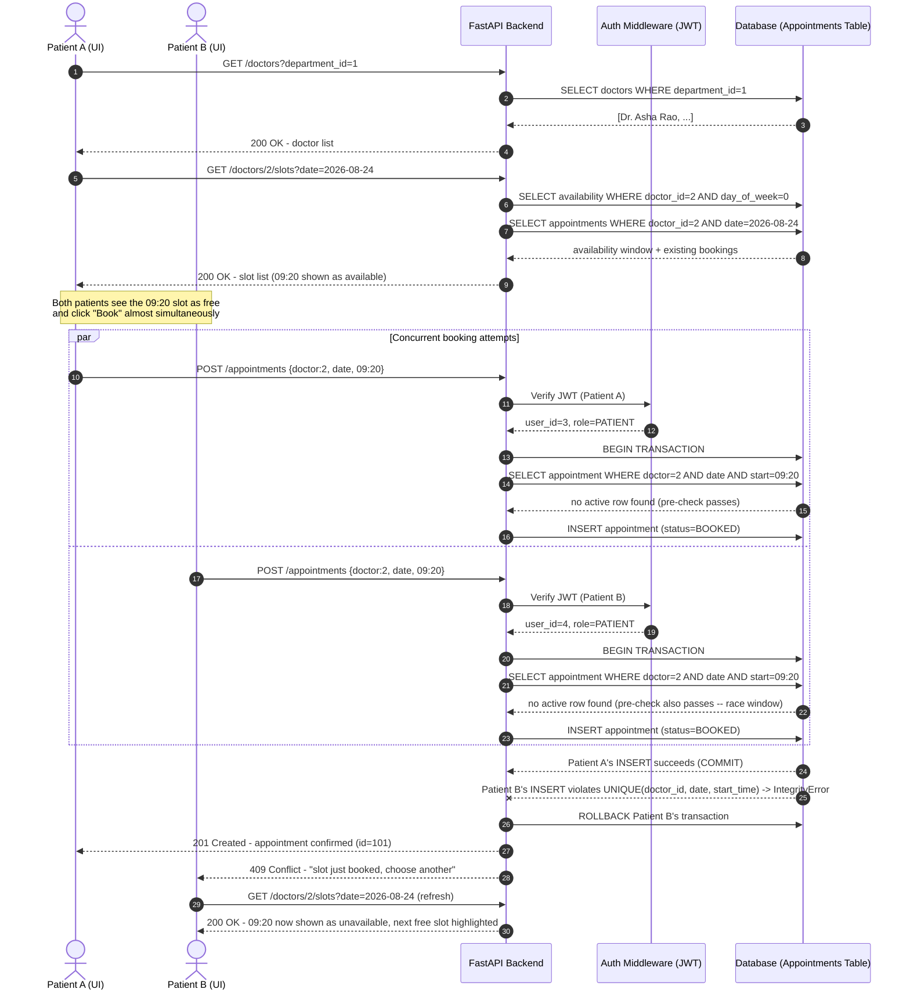

# 1. Requirement Analysis & Design
## Hospital Appointment Management System (HAMS)

---

## 1.1 User Stories & Acceptance Criteria

Stories are written in the standard `As a <role>, I want <goal>, so that <benefit>` format, each with Gherkin-style acceptance criteria (`Given / When / Then`) so they double as manual test cases.

### 🧑 Patient Stories

**US-P1: Patient Registration**
> As a new patient, I want to create an account with my basic details, so that I can log in and book appointments without visiting the hospital.

- **AC1:** Given valid name, email, phone, and password, when I submit registration, then a new account is created with role `PATIENT` and I receive a `201 Created` response.
- **AC2:** Given an email that is already registered, when I submit registration, then the system rejects it with `400 Bad Request` and a clear error message.
- **AC3:** Given a password shorter than 6 characters, when I submit registration, then the system rejects it with a validation error before hitting the database.

**US-P2: Patient Login**
> As a registered patient, I want to log in securely, so that only I can access my medical appointment data.

- **AC1:** Given correct email/password, when I log in, then I receive a signed JWT access token valid for 8 hours.
- **AC2:** Given an incorrect password, when I log in, then I receive `401 Unauthorized` with a generic "incorrect email or password" message (no hint on which field is wrong, to prevent user enumeration).
- **AC3:** Given a deactivated account, when I log in with correct credentials, then I receive `403 Forbidden`.

**US-P3: Search Doctors by Department/Specialty**
> As a patient, I want to search/filter doctors by department or specialty, so that I can find the right doctor for my condition.

- **AC1:** Given I select "Cardiology," when I search, then only doctors in that department are returned.
- **AC2:** Given I enter a free-text specialty like "skin," when I search, then doctors whose specialization matches (case-insensitive, partial match) are returned.
- **AC3:** Given no filters are applied, when I search, then all active doctors are returned.

**US-P4: View Available Slots**
> As a patient, I want to see a doctor's open time slots for a chosen date, so that I know exactly when I can book.

- **AC1:** Given a doctor works Mon–Fri 9 AM–1 PM in 20-minute slots, when I request slots for a Monday, then I see 12 slots between 09:00–13:00.
- **AC2:** Given some slots are already booked, when I view availability, then booked slots are clearly marked `is_available: false` (not hidden — so the patient understands the schedule is full, not broken).
- **AC3:** Given I request a date the doctor doesn't work (e.g., Sunday), when I view availability, then I receive an empty list, not an error.

**US-P5: Book an Appointment**
> As a patient, I want to book an open slot with a doctor, so that I can be guaranteed a consultation time without calling the front desk.

- **AC1:** Given a slot is available, when I book it, then an appointment record is created with status `BOOKED` and I receive a confirmation with appointment ID.
- **AC2:** Given the slot was booked by someone else microseconds earlier, when I try to book it, then I receive `409 Conflict` — never a silent double-booking.
- **AC3:** Given I try to book a date in the past, when I submit, then I receive `400 Bad Request`.

**US-P6: Cancel an Appointment**
> As a patient, I want to cancel an upcoming appointment, so that I can free the slot if my plans change.

- **AC1:** Given my appointment is `BOOKED`, when I cancel it, then its status changes to `CANCELLED` and the slot becomes bookable again for other patients.
- **AC2:** Given the appointment belongs to a different patient, when I try to cancel it, then I receive `403 Forbidden`.
- **AC3:** Given the appointment is already `COMPLETED`, when I try to cancel it, then I receive `400 Bad Request`.

**US-P7: View Appointment History**
> As a patient, I want to view all my past and upcoming appointments, so that I can track my consultation history.

- **AC1:** Given I have 3 appointments (1 upcoming, 2 past), when I view history, then all 3 are returned sorted by date descending.

---

### 🩺 Doctor Stories

**US-D1: Manage Availability**
> As a doctor, I want to define my working days, hours, and slot duration, so that patients only see times I am actually available.

- **AC1:** Given I set Mon–Fri, 09:00–13:00, 20-minute slots, when a patient requests my slots for a Monday, then the system generates 12 slots automatically (no manual slot creation needed).
- **AC2:** Given I add an availability window with `end_time <= start_time`, when I save it, then the system rejects it with a validation error.

**US-D2: View Daily Appointment Queue**
> As a doctor, I want to see today's appointment queue at a glance, so that I know who's coming and in what order.

- **AC1:** Given I have 4 appointments today, when I open my queue, then I see all 4 sorted chronologically by slot start time, with patient and status info.
- **AC2:** Given I request a specific date, when I open my queue for that date, then only that date's appointments are shown.

**US-D3: Update Consultation Status**
> As a doctor, I want to mark each appointment as Completed, In-Progress, or No-Show, so that the hospital has an accurate record of consultations.

- **AC1:** Given a patient's appointment is `BOOKED` and I start seeing them, when I mark it `IN_PROGRESS`, then the status updates immediately and is visible to admin reports.
- **AC2:** Given a patient never shows up, when I mark it `NO_SHOW`, then it's excluded from "completed consultations" metrics but retained for audit history.
- **AC3:** Given the appointment belongs to a different doctor, when I try to update its status, then I receive `403 Forbidden`.

---

### 🛠️ Administrator Stories

**US-A1: Manage Departments/Specialties**
> As an administrator, I want to create and maintain the list of departments, so that doctors can be correctly categorized and patients can search accurately.

- **AC1:** Given a unique department name, when I create it, then it becomes immediately searchable by patients.
- **AC2:** Given a duplicate department name, when I try to create it, then I receive `400 Bad Request`.

**US-A2: Manage Doctors**
> As an administrator, I want to onboard doctor accounts and assign them to departments, so that the hospital's doctor directory stays accurate and centrally controlled (doctors do not self-register, for credential-verification reasons).

- **AC1:** Given valid doctor details and an existing department, when I create a doctor account, then a login-capable `DOCTOR` user and linked doctor profile are created in one transaction.
- **AC2:** Given an email already in use, when I try to create the doctor, then I receive `400 Bad Request`.

**US-A3: System Oversight & Reporting**
> As an administrator, I want an operational dashboard of appointment volume and statuses, so that I can monitor hospital load and doctor utilization.

- **AC1:** Given appointments exist in various statuses, when I request the summary report, then I see total appointments, today's load, and a breakdown by status (Booked/Cancelled/Completed/In-Progress/No-Show).
- **AC2:** Given I am not an admin, when I try to access the report endpoint, then I receive `403 Forbidden`.

---

## 1.2 Sequence Diagram — Patient Appointment Booking Workflow

The diagram below traces a booking request through UI → API → DB validation → confirmation, **including the concurrency/race-condition path** where two patients attempt the same slot.



**Key design point:** the application-level `SELECT` check gives good UX (fast, friendly error) in the common case, but it is the **database UNIQUE constraint** that is the real source of truth — it is the only thing that cannot be defeated by a race condition, because the DB engine serializes conflicting writes at the storage layer regardless of how close together the two requests arrive.

---

## 1.3 Database Design — Entity-Relationship Schema

### 1.3.1 ER Diagram

```mermaid
erDiagram
    USERS ||--o| PATIENTS : "extends"
    USERS ||--o| DOCTORS : "extends"
    DEPARTMENTS ||--o{ DOCTORS : "has"
    DOCTORS ||--o{ DOCTOR_AVAILABILITY : "defines"
    DOCTORS ||--o{ APPOINTMENTS : "attends"
    PATIENTS ||--o{ APPOINTMENTS : "books"

    USERS {
        int user_id PK
        string full_name
        string email UK
        string phone
        string password_hash
        string role "PATIENT|DOCTOR|ADMIN"
        bool is_active
        datetime created_at
    }
    DEPARTMENTS {
        int department_id PK
        string name UK
        string description
    }
    PATIENTS {
        int patient_id PK_FK
        date date_of_birth
        string gender
        string address
        string blood_group
    }
    DOCTORS {
        int doctor_id PK_FK
        int department_id FK
        string specialization
        string qualification
        int experience_years
        decimal consultation_fee
    }
    DOCTOR_AVAILABILITY {
        int availability_id PK
        int doctor_id FK
        smallint day_of_week
        time start_time
        time end_time
        smallint slot_duration_mins
        bool is_active
    }
    APPOINTMENTS {
        int appointment_id PK
        int patient_id FK
        int doctor_id FK
        date appointment_date
        time slot_start_time
        time slot_end_time
        string status "BOOKED|CANCELLED|COMPLETED|IN_PROGRESS|NO_SHOW"
        string reason
        datetime created_at
        datetime updated_at
    }
```

### 1.3.2 Relational Schema (DDL)

The full, executable SQL DDL — including primary keys, foreign keys, `CHECK` constraints, and the **double-booking-prevention constraints** — is provided as a standalone file: **`database/schema.sql`** (see attached files). Key excerpts:

| Table | Primary Key | Foreign Keys | Notable Constraints |
|---|---|---|---|
| `users` | `user_id` | — | `email` UNIQUE; `role` CHECK IN (PATIENT, DOCTOR, ADMIN) |
| `departments` | `department_id` | — | `name` UNIQUE |
| `patients` | `patient_id` | → `users.user_id` (CASCADE) | `gender` CHECK IN (MALE, FEMALE, OTHER) |
| `doctors` | `doctor_id` | → `users.user_id`, → `departments.department_id` | — |
| `doctor_availability` | `availability_id` | → `doctors.doctor_id` (CASCADE) | `end_time > start_time`; UNIQUE(doctor, day, start, end) |
| `appointments` | `appointment_id` | → `patients.patient_id`, → `doctors.doctor_id` | **`UNIQUE(doctor_id, appointment_date, slot_start_time)`** + partial UNIQUE index on active statuses only — the core anti-double-booking rule |

**Why this specific constraint design prevents double-booking:**
1. A plain `UNIQUE(doctor_id, appointment_date, slot_start_time)` stops two *active* bookings for the same doctor/slot — but it would also incorrectly block re-booking a slot after a cancellation, since the cancelled row still occupies that tuple.
2. The migration therefore also creates a **partial unique index** (`WHERE status IN ('BOOKED','IN_PROGRESS','COMPLETED')`) so cancelled rows don't block future bookings, while active bookings remain fully protected.
3. Combined with `status CHECK` and `end_time > start_time` on availability, the schema makes several classes of data corruption structurally impossible rather than relying purely on application code.
